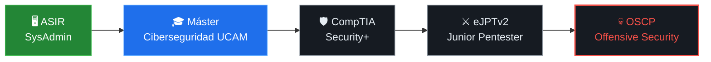

<p align="center">
  
</p>

<p align="center">
  
  
  
</p>

---

## `> cat sobre_mi.md`

Soy **Técnico Superior en Administración de Sistemas Informáticos en Red (ASIR)**. Vengo de montar servidores, configurar redes, gestionar usuarios y permisos y mantener servicios en pie.

Ahora estoy dando el salto a la **ciberseguridad**: curso el **Máster Internacional en Ciberseguridad (UCAM)** y entreno a diario en mi propio laboratorio y en plataformas de hacking ético.


---

## `> nmap -sV p3drosec`

```text
Starting Nmap scan on p3drosec ( github.com/p3drosec )
Nmap scan report for Pedro Fernández
Host is up, learning fast.

PORT       STATE   SERVICE            VERSION
22/tcp     open    linux-sysadmin     Debian / Ubuntu · servicios, usuarios, permisos
53/tcp     open    networking         TCP/IP · DNS · DHCP · subnetting · VLAN
80/tcp     open    web-stack          Apache · PHP · MySQL
389/tcp    open    windows-server     Active Directory · GPO · dominios
1337/tcp   open    ethical-hacking    Kali Linux · reconocimiento · explotación   [training]
3306/tcp   open    databases          MySQL · SQL
8080/tcp   open    scripting          Python · Bash · automatización
9999/tcp   open    blue-team          análisis de tráfico · logs · hardening        [training]

Service Info: OS: Linux / Windows · Mindset: curioso, constante, autodidacta
Nmap done: 1 human scanned — 0 excuses found
```

---

## `> ls ~/arsenal/`

**🖥️ Sistemas, redes y código**

<p align="left">
  
</p>

**🔴 Ofensiva · Red Team** <sub>(en entrenamiento)</sub>

<p align="left">
  
  
  
  
  
</p>

**🔵 Defensiva · Redes · Blue Team**

<p align="left">
  
  
  
  
  
</p>

**🧪 Laboratorio y entrenamiento**

<p align="left">
  
  
  
</p>

---

## `> ./roadmap.sh`



<sub>🟩 completado · 🟦 en curso · ⬛ siguiente · 🟥 objetivo</sub>

---

## `> cat mision_actual.log`

- [x] Título de **Técnico Superior en ASIR**
- [x] Laboratorio de pentesting con **Kali Linux + VirtualBox**
- [ ] **Máster Internacional en Ciberseguridad** · UCAM — *en curso*
- [ ] Ruta **Pre-Security** de TryHackMe — *en curso*
- [ ] Publicar mis primeros **writeups** y **herramientas en Python**
- [ ] Certificación **CompTIA Security+**

---

<!--
## `> ./contacto.sh`

<p align="left">
  <a href="https://www.linkedin.com/in/TU_LINKEDIN"></a>
  <a href="mailto:TU_EMAIL"></a>
</p>
-->

---

<p align="center">
  <code>"Para defender un sistema, primero hay que entender cómo funciona."</code>
  <br/><br/>
  <sub>┌──(p3drosec@kali)-[~] └─$ <b>exit</b> · <i>gracias por pasarte</i> 🛡️</sub>
</p>
